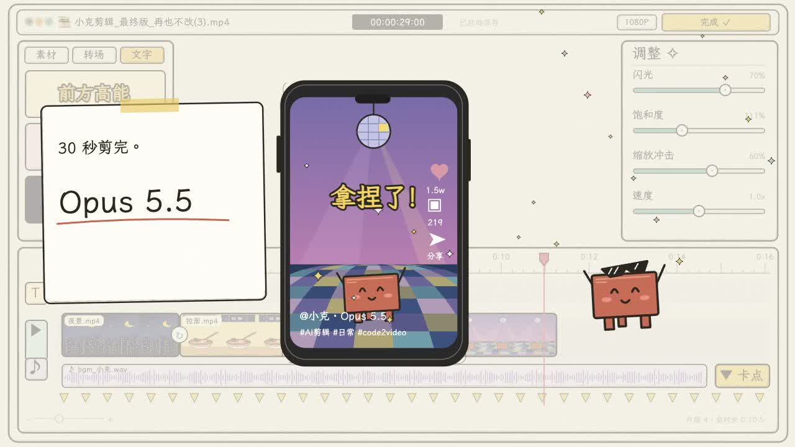

# Claude 剪视频过程 · Remotion 复刻

一个 30.067 秒的手绘风格剪辑器动画，使用 React、SVG 和 Remotion 重建。素材面板、手机预览、时间轴、红色方块角色、调节滑杆及结尾卡片均可编辑；没有将参考视频作为画面播放。

对应动效片段：[e3ee409a-50f7-4b4a-af27-288226e47a57](https://motionface.cc/?recording=e3ee409a-50f7-4b4a-af27-288226e47a57)。



## 运行与渲染

需要 Node.js 22 或更高版本、npm，以及 Remotion 支持的 Chrome 浏览器。首次渲染时 Remotion 可下载浏览器。

```bash
npm ci
npm start
npm run typecheck
npm run render
npm run still
```

- Studio：运行 `npm start` 后打开终端提示的本地地址。
- 完整视频：`out/claude-editor.mp4`
- 预览图：`out/preview.png`
- 合成 ID：`EditorStory`
- 参数：1280 × 720，30 fps，902 帧，H.264 / AAC。

已有 Chrome 时，可以直接指定浏览器，例如 macOS：

```bash
npm run render -- --browser-executable="/Applications/Google Chrome.app/Contents/MacOS/Google Chrome"
```

导出指定帧：

```bash
npx remotion still src/index.ts EditorStory out/frame-450.png --frame=450
```

## 结构

- `src/Root.tsx`：分辨率、帧率和总长度。
- `src/EditorStory.tsx`：镜头、编辑界面、时间轴、转场、角色动作、字幕、结尾与音轨。
- `src/Art.tsx`：手绘框线、文字、星星、红色角色，以及夜景、拉面、柴犬、舞池四组 SVG 插画。
- `public/fonts/`：本地化的霞鹜文楷 TC 字体子集及 SIL OFL 许可证。
- `public/reference-audio.m4a`：从用户提供的参考视频提取的音轨，用于保持原片节奏。
- `docs/analysis.md`：参考视频拆解、时间线与复刻边界。
- `docs/verification.md`：实际渲染与发布验证记录。

修改动画时，所有时间以秒为单位，由 `useCurrentFrame() / 30` 驱动。画面是确定性的，支持任意帧寻址。字体等待加载后才开始渲染。当前字体子集包含本项目用字；添加其他汉字时请扩充子集或替换为完整的 OFL 字体。

## 素材与复刻边界

这是按照用户提供的参考视频制作的组件化视觉复刻，保留构图、配色、叙事顺序和主要动效；手绘笔触、个别插画细节及动作曲线为重新绘制，不是逐像素复制。参考视频的完整画面和临时下载地址不包含在仓库中。

代码和重新绘制的 SVG 在本项目中提供。参考音轨及参考作品的权利归其原权利人；本仓库不为这些素材授予额外许可。字体依据 `public/fonts/OFL.txt` 分发。Remotion 的使用条款请参考其官方说明。

参考技术文档：[Remotion Composition](https://www.remotion.dev/docs/composition)、[Remotion rendering](https://www.remotion.dev/docs/render)。
